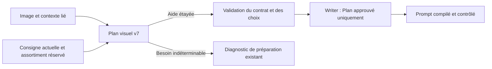

# Petits hommes experimental — proposition v7 : une aide adaptée à l'intention de l'image

Statut : **proposition approuvée pour implémentation le 29 octobre 2026**. Ce document conserve le détail de conception préparé avant l'autorisation ; le comportement livré est décrit dans [la documentation Usine](../video-factory.md). L'audit et la rédaction de cette proposition n'avaient modifié aucun réglage, Plan, Prompt, fichier applicatif ou service, ni lancé de génération ou de test.

Périmètre proposé : faire évoluer **Petits hommes experimental** (`little_men_variety`) vers une direction v7. **Petits hommes** (`little_men_experimental`, v5) et les préparations historiques restent compatibles. Conserver dix secondes, un plan continu, la banque d'objets et les deux appels Plan puis Writer.

## 1. Ce que nous avons déjà

Audit du batch `creation-batch-a77f706b4f6a40a49a227316d2fadbcd`, créé le 29 octobre à 17:21 UTC, contenant les 24 intentions `PM-V2-20261029-001` à `024`.

| Vérification sur les fiches Usine | Résultat |
| --- | --- |
| Contexte associé à l'image de référence | 24/24 |
| Identifiant du contexte = image de référence = sortie du batch = sortie de la tentative image | 24/24 |
| Intention récupérée identique à l'intention originale du batch | 24/24 |
| Prompt récupéré identique au prompt ou au prompt canonique de la tentative exacte | 24/24 |
| Origine enregistrée du contexte | `PNG KREA / ComfyUI`, 24/24 |
| Champ de style séparé renseigné | 0/24 ; cela ne signifie pas que l'image ou son prompt n'ont pas de style |

Les données sont déjà dans `config.references[].scene_context` : `asset_id`, `origin`, `intention`, `prompt`, `style`. Sur ce batch, l'intention la plus longue fait 709 caractères et le prompt le plus long 1 122 caractères. Les fiches sont encore au preset `source`, avec Plan en attente lors du relevé. Le champ d'intention vidéo vide ne signifie donc pas que l'intention image est perdue.

Le fournisseur existant lit la métadonnée PNG ou une tentative KREA exactement liée à l'asset. Pour ce batch, le chemin passe par le PNG ; une comparaison indépendante avec les tentatives des projets confirme la correspondance. Le relevé est enregistré dans [metadata-audit.json](../../.agent/diagnostics/petit-homme-adaptive-proposal-20261029/metadata-audit.json).

Le circuit de préparation des presets Petits hommes transmet **déjà** un contexte contenant l'intention et le prompt de l'image. Les 24 Plans étant en attente, aucun envoi au modèle n'a été observé pour ce batch. Le défaut principal vient du cadre imposé : les consignes v5/v6 et `HelpContract` exigent un danger et une menace active. Le modèle peut alors dramatiser une activité ou traiter un bénéficiaire comme un adversaire pour satisfaire le contrat. C'est un risque déduit du code ; aucune vidéo de ce nouveau batch n'a été évaluée.

La récupération n'est pas garantie pour toute image importée : métadonnées absentes ou retirées, formats sans ce contexte, provenance incomplète. De plus, l'intention embarquée est capturée à la soumission du rendu ; pour les projets en général, elle n'est pas une preuve immuable de l'intention au moment où le prompt a été rédigé. La concordance a été vérifiée pour les 24 images présentes.

## 2. Lecture du contexte proposée

Ne pas ajouter de classificateur, de troisième appel LLM ou de recherche dans le dernier projet modifié. Réutiliser le contexte lié à l'image exacte, dans une section de données explicitement destinée au Plan.

| Source | Rôle |
| --- | --- |
| Consigne vidéo ou correction explicite de l'utilisateur | Définit l'aide souhaitée et les contraintes actuelles ; une transformation de l'image doit rester montrée, pas supposée déjà accomplie. |
| Image de référence | Fixe l'état visible initial : personnes, êtres, objets, positions, matières et relations spatiales. |
| Intention originale liée à cet asset | Éclaire l'objectif, les rôles, les efforts en cours et les phénomènes que l'image fixe explique mal. |
| Prompt canonique de la tentative, ou prompt exécuté à défaut | Complète la description et le contexte ; le canonique peut omettre la direction artistique ajoutée au prompt exécuté. Ses prescriptions de composition d'image ne deviennent pas automatiquement des prescriptions vidéo. |
| Style récupéré | Complément descriptif facultatif ; l'image reste la référence visuelle. |

Ce n'est pas une priorité aveugle entre textes. L'image tranche les faits directement visibles ; l'intention peut expliquer une causalité, un mouvement ou une règle fantastique qu'une image fixe ne prouve ni ne réfute. L'absence de mouvement dans une seule image n'est pas une contradiction. En cas de désaccord mineur, retenir l'interprétation compatible avec l'image et la demande actuelle. Un conflit matériel empêchant toute aide cohérente doit être signalé, pas résolu par invention.

Le contexte est informatif : ignorer anciennes paroles, ordres adressés au modèle et anciennes consignes vidéo qui contredisent la direction actuelle. Un outil déjà utilisé par les habitants ne prescrit pas l'accessoire de la main. Ne pas déduire des faits du nom de fichier, du titre du batch ou de la langue dans laquelle le prompt est rédigé.

Pour la v7 uniquement, conserver l'intention récupérée et transmettre le prompt stocké jusqu'à sa borne existante de 12 000 caractères, au lieu de l'extrait début/fin d'environ 1 200 caractères. Cela évite de perdre une relation causale au milieu du texte. Sur ce batch, ce changement n'augmente pas sensiblement le contexte. Les bornes existantes restent 4 000 caractères pour l'intention et 3 000 pour le style ; on ne prétend pas reconstituer un original déjà tronqué par le fournisseur.

Séparer cette section du texte destiné au Writer. Le Writer reçoit l'interprétation retenue, les invariants, les actions et les choix approuvés dans le Plan ; il ne relit pas les métadonnées brutes pour choisir une autre histoire. Le constructeur v7 doit retirer explicitement ce bloc, sans modifier le comportement historique de `writer_intention()` pour v1–v6.

## 3. Toutes les règles narratives et de variété

1. **Commencer par l'objectif et le besoin réel.** Comprendre ce que les habitants ou le bénéficiaire cherchent déjà à accomplir, ce qui les gêne et quelle contribution de la main serait utile. Une difficulté, un effort ou une activité à faciliter suffit ; aucune urgence obligatoire.
2. **Respecter les rôles.** Un animal peut être une menace, un bénéficiaire ou un élément neutre. Ne pas le requalifier pour satisfaire le format. Le bénéficiaire peut aussi être un groupe, un lieu ou une ressource.
3. **Rendre un danger établi perceptible et actif.** Si un animal est réellement menaçant dans cette scène, son comportement doit le montrer et réagir à l'intervention. Ne pas ajouter une attaque, une catastrophe ou une aggravation pour fabriquer un besoin. Un obstacle statique peut rester statique jusqu'au contact utile.
4. **Prolonger les efforts déjà engagés.** La main aide les actions des habitants, sans les faire recommencer ni effacer gratuitement leur travail. Préserver les propriétés fantastiques du monde ; tout changement utile de ces propriétés doit découler de l'intervention montrée, pas d'un retour arbitraire à une normalité supposée.
5. **Choisir une opération utile avant de choisir son accessoire.** Identifier la cible et l'effet recherché. Moyens libres : main seule ou accessoires facultatifs. Le catalogue ne doit pas créer artificiellement un problème auquel un objet conviendrait.
6. **Conserver la variété organisée.** Banque existante de 80 objets, 12 candidats proposés par fiche, mémoire bornée aux 50 autres fiches récentes prises en compte par le mécanisme existant. Garder la réservation persistée avant l'appel et le remplacement de l'exposition provisoire par l'usage réel une fois connu. Aucun couple problème→objet imposé, aucun scénario résolu ni exemple du batch ajouté aux consignes.
7. **Varier aussi l'opération physique.** Garder les dix familles existantes : relier, séparer, déplacer, rediriger, absorber/retirer, remodeler, agir sur la température, soutenir, contenir, faire écran. `other` reste possible uniquement si aucune famille ne convient. La préférence pour les familles moins utilisées est souple ; pertinence et lisibilité priment sur la nouveauté. Classer le mécanisme principal, pas chaque geste préparatoire comme une solution différente.
8. **Autoriser un choix hors assortiment ou la main seule**, avec raison explicite dans le Plan. Le choix effectif et le mécanisme alimentent la mémoire. Le nom d'un objet déclaré doit apparaître dans l'intervention qui l'utilise. Ces contrôles ne prouvent pas sa pertinence physique.
9. **Bannir parapluie, parasol et ombrelle**, même hors catalogue et même dans un prompt final personnalisé avant une nouvelle soumission. Les simples exclusions négatives ne sont pas des objets sélectionnés.
10. **Montrer la causalité.** Une intervention, éventuellement composée de plusieurs gestes utiles, agit sur une cible qui réagit. Le résultat doit être observable et persister au-delà du geste décisif. Pas de quota artificiel de gestes, d'accessoires ou de sous-problèmes ; retirer les actions qui n'aident pas à comprendre le changement.
11. **Montrer le bénéfice avant la gratitude.** Les habitants utilisent, poursuivent ou apprécient le résultat quand cela a du sens. Si l'aide vise un autre bénéficiaire, montrer son amélioration et une réaction humaine cohérente ; ne pas imposer que les habitants consomment eux-mêmes le résultat.
12. **Conserver dix secondes et un seul plan continu.** Faire vivre l'état initial pendant l'approche de la main et laisser du temps à l'effet utile. Pas de découpage temporel rigide ni de pause obligatoire pour chaque étape du contrat.
13. **Un merci unique, bref et naturel**, de l'ordre d'une seconde, à la fin, sans longue célébration ni pose collective imposée. Il peut accompagner l'activité qui reprend. Conserver les onze langues/formules, la priorité au choix manuel et le mécanisme existant de sélection automatique. Aucune autre réplique tirée de la métadonnée image.
14. **Ne pas inventer un besoin absent.** Quand ni l'image ni l'intention ni la demande actuelle ne permettent d'identifier une contribution utile, ou qu'un conflit majeur reste insoluble, produire un diagnostic avant la rédaction du Prompt. Une scène calme avec un effort ou un objectif identifiable ne doit pas être bloquée pour cette raison.

## 4. Contrat structuré v7

Créer un `AdaptiveHelpContract` séparé ; garder `HelpContract` v5/v6 intact. Le Plan v7 conserve les rubriques Classique existantes, `continuity_invariants`, une seule parole de remerciement et `variety_choice`.

| Champ proposé dans `help_contract` | Contenu |
| --- | --- |
| `initial_goal` | Objectif initial étayé par l'image ou le contexte, sans imposer déjà une solution. |
| `help_need` | Difficulté, effort ou amélioration concrète justifiant l'aide. |
| `beneficiary` | Entité bénéficiant directement du résultat. |
| `target` | Élément physique sur lequel porte l'intervention. |
| `mechanism` | Opération choisie et lien causal avec son effet. |
| `lasting_result` | Changement utile qui subsiste. |
| `benefit_description` | Manifestation observable du bénéfice. |
| `initial_state` | Référence vers l'action décrivant l'état initial ; cet état peut être statique. |
| `threat` | `null` sans danger établi ; sinon `{description, evidence: ActionRef}`. |
| `intervention` | Liste non vide et ordonnée de références vers les gestes utiles. |
| `resolution` | Référence vers la preuve du changement utile. |
| `benefit` | Référence vers le bénéfice observable. |
| `thanks` | Référence vers le remerciement final. |

Les chaînes descriptives seront non vides et bornées comme dans le contrat existant ; `ActionRef` conserve ses indices de phase/action. Les efforts en cours, les rôles et les règles du monde vont dans `continuity_invariants`, sans autre sous-modèle de classification.

Ordre contrôlé :

```text
initial_state < première intervention
si threat != null : threat.evidence < première intervention
première intervention <= dernière intervention <= resolution
resolution < benefit <= thanks == dernière action
```

L'état initial et une éventuelle menace peuvent partager une même action. La dernière intervention peut prouver le résultat. Bénéfice et merci peuvent partager la dernière action si le texte montre d'abord le bénéfice, puis la parole. Une entrée d'action n'impose aucune durée fixe : ces références préservent la lisibilité sans rallonger les dix secondes.

Conserver le transport protégé des actions Plan→Writer, leur ordre, leur présence exacte une fois et la validation du Prompt final. Ajouter l'aiguillage explicite vers le contrat v7 dans `validate_contract`, `protected_actions` et `validate_variety_choice`, qui convertissent actuellement vers `HelpContract`. Le simple remplacement des consignes ou du schéma exposé au LLM ne suffirait pas.

Le code valide structure, références, ordre, parole unique, identité des objets et absence d'objets interdits. Il ne sait pas certifier que l'interprétation de la scène ou le mécanisme physique est juste ; cette limite doit rester explicite.

## 5. Besoin réellement indéterminable

Le schéma de réponse Plan v7 accepte deux formes disjointes : `AdaptiveVarietyPlan` complet, ou `HelpContextRequest` contenant uniquement `status: "needs_context"` et un `reason` non vide borné à 600 caractères. Aucun exemple de scène ni de solution n'accompagne ce schéma.

Le chemin nominal garde la forme du Plan existant : pas d'enveloppe supplémentaire, pas de contrat ou de scène rendus facultatifs. Pour la branche de diagnostic :

1. `canonical_plan` reconnaît et valide la réponse avant le modèle de Plan normal.
2. Il produit une erreur métier lisible expliquant l'information manquante ou le conflit concret.
3. La révision n'est pas approuvée ; le flux Usine existant marque l'étape Plan en échec et conserve la trace LLM rejetée.
4. Le Writer n'est pas appelé, aucune vidéo n'est lancée. Pas de boucle de reformulation ni de troisième appel. L'utilisateur peut compléter le contexte puis relancer par le flux existant.

Ne pas créer un nouvel état global de fiche ni une confirmation systématique. Le coût nominal reste deux appels ; une réponse `needs_context` s'arrête après le Plan. L'absence de métadonnées seule ne déclenche pas cette branche : une image suffisamment explicite permet de continuer.



## 6. Points d'implémentation futurs

Chemins relatifs à `src/panelforge/`, sauf indication contraire.

| Fichier | Modification prévue |
| --- | --- |
| `domain/localized_speech.py` | Ajouter la politique `little_men.localized_thanks.v7` sans changer v1–v6. |
| `domain/video_factory.py` | Intention v7 propre à l'experimental ; application explicite du preset fixe le marqueur 7 ; adapter validation, invalidation et compatibilité. Ne pas construire la nouvelle intention par simple ajout au texte v5 qui impose le danger. |
| `domain/little_men_direction.py` | Préparation et politiques v7 ; contexte image distinct destiné au Plan, pas d'extrait court pour le prompt v7, extraction spécifique pour le Writer. Garder les fonctions/textes historiques. |
| `domain/little_men_languages.py` | `make_selection` respecte le marqueur de version existant au lieu de déduire la version du seul preset ; sélection figée version 7 quand demandée. Conserver langue, contexte et identifiants dans les entrées de sélection et d'invalidation. |
| `domain/little_men_variety.py` | Variante v7 des consignes : objectif/besoin avant objet. Catalogue, familles, historique et sélection inchangés ; garder la variante v6. |
| `application/little_men_prompting.py` | Systèmes Plan/Writer v7 et `creative_policy` cohérents ; retirer toute menace ou animation universellement imposée. Ne pas hériter silencieusement de ces clauses v5/v6. |
| `application/vocal_policy.py` | Ajouter v7 aux branches explicites de politique et validation de parole, avec bénéfice éventuellement non humain, onze langues/formules et merci bref. Éviter le repli v1. L'obligation de parole concerne uniquement un Plan prêt, jamais `needs_context`. |
| `application/little_men_causal.py` | Nouveau contrat, danger nullable, bénéficiaire général, références et ordre ; transport protégé et choix de variété compatibles avec les deux contrats. |
| `application/classic_cinematic.py` | Nouveau `AdaptiveVarietyPlan`, schéma alternatif de diagnostic, routage par politique, lint et compilation. Ne pas caster le contrat v7 vers l'ancien modèle. |
| `application/prompt_composition.py` | Routage v7 ; entrée Plan enrichie, entrée Writer limitée au Plan résolu ; contrôle de la politique, du contexte, de l'assortiment et du Plan approuvé lors d'une édition finale. Préserver le Plan indexé pour les révisions. |
| `application/video_factory_workflows.py` | Reconnaître v7 dans préparation, persistance langue/choix et contrôle avant vidéo. Réutiliser l'enrichissement existant, sans modifier automatiquement le contexte historique. |
| `application/video_factory.py` | Le choix de version à l'exécution respecte lui aussi le marqueur existant, y compris avant la première sélection. Réservation v7 sous verrou avant l'appel ; choix effectif enregistré après validation ; diagnostic traité par l'échec de préparation existant. |
| `docs/video-factory.md` | Décrire l'aide sans danger obligatoire, l'usage du contexte, la version et le diagnostic. À modifier seulement lors de l'implémentation. |

Ne pas ajouter de dépendance, de table de scénarios, de moteur séparé d'interprétation ou de champs à remplir pour chaque image. L'interface existante de contexte et le message d'échec suffisent pour ce patch ; vérifier leur lisibilité pendant l'implémentation.

## 7. Versionnement et migration

- Le nom public reste **Petits hommes experimental** et l'ID reste `little_men_variety`.
- Une nouvelle application de ce preset sélectionne v7. Le preset normal **Petits hommes** conserve v5.
- Une fiche explicitement marquée v6 reste v6, même si son Plan n'a pas encore été préparé. Les sélections et préparations figées v1–v6 gardent leurs textes, schémas, empreintes et résultats approuvés.
- Migrer une fiche existante exige une réapplication explicite du preset ; les étapes dérivées sont invalidées par le mécanisme existant. Préserver le choix de langue compatible ; retirer le choix de solution résolu devenu obsolète et réserver l'assortiment correspondant à la nouvelle version avant sa préparation.
- Aucun Plan v6 n'est converti silencieusement en contrat v7. Une ancienne vidéo soumise ou terminée reste consultable/réconciliable. Le contrôle du parapluie s'applique avant une nouvelle soumission.
- Garder le traitement historique des marqueurs absents/`None` et les signatures compatibles ; ne pas changer rétroactivement leurs empreintes ni les utiliser pour une migration implicite vers v7. L'application explicite du preset établit le nouveau marqueur.
- Aucun changement de fiche en masse, rendu, synchronisation vers le dossier de lancement ou redémarrage n'appartient à la présente proposition.

## 8. Vérifications à prévoir lors de l'implémentation

Écrire les régressions adaptées ; **leur exécution revient à l'utilisateur**, conformément aux instructions du projet. Pas d'appel réel à un LLM ou à un moteur de génération pour vérifier ce patch.

| Cas | Attendu |
| --- | --- |
| Contexte lié au bon asset et intention présente | Le Plan reçoit le contexte ; une autre tentative ou un autre asset ne le remplace pas. |
| Prompt long contenant une relation au milieu | Le bloc Plan v7 conserve cette partie dans la limite du contexte stocké ; le Writer ne reçoit pas ce texte brut. |
| Métadonnées absentes, image suffisante | Préparation nominale possible, aucun besoin obligatoire d'une métadonnée. |
| Difficulté sans menace | `threat=null` valide ; état initial statique accepté ; besoin et bénéfice requis. |
| Danger étayé | Description et référence de menace obligatoires ensemble, référence avant intervention ; contrôler aussi cette consigne lors de la revue qualitative. |
| Bénéficiaire non humain | Son bénéfice est accepté avant le merci humain ; pas de champ imposant un usage humain. |
| Efforts et phénomène fantastique | Invariants transmis au Writer ; actions approuvées conservées exactement dans le Prompt compilé. Vérifier qualitativement que la rédaction reste cohérente avec ces invariants. |
| Aucun besoin étayé ou conflit majeur | Diagnostic lisible ; zéro Writer, zéro génération, zéro Plan approuvé, pas de relance automatique. |
| Références inexistantes, ordre erroné ou seconde parole | Rejet explicite ; les variantes permissives ne contournent pas le contrat. |
| Consignes agrégées et parole | Politique v7 reconnue aussi par `vocal_policy` ; pas de clause héritée exigeant danger ou bénéfice humain ; onze formules contrôlées sur un Plan prêt, aucune parole exigée de `needs_context`. |
| Choix de variété | Banque et rotation inchangées ; objet déclaré présent dans l'intervention ; raison nécessaire pour main seule/hors assortiment ; famille principale enregistrée. |
| Parapluie/parasol/ombrelle | Toujours refusés en utilisation, y compris avant vidéo avec Prompt personnalisé ; une exclusion négative reste admissible. |
| Édition du Prompt final | Ne peut pas remplacer la solution approuvée ni réutiliser un contexte de Plan périmé. |
| Compatibilité | Fixtures v5/v6 inchangées ; sélections figées, signatures, réservations et reprise conservées ; migration uniquement explicite. |
| Fiche v6 sans sélection ni Plan | Reste v6 à sa première préparation ; réapplication explicite du preset avant préparation sélectionne v7. Vérifier le constructeur de sélection et l'exécution Usine. |
| Nombre d'appels | Deux appels sur le chemin nominal ; un seul si le Plan renvoie `needs_context`. |

Suites concernées : `tests/test_little_men_causal.py`, `test_little_men_variety_contract.py`, `test_little_men_variety.py`, `test_classic_cinematic.py`, `test_video_factory_causal.py`, `test_video_factory_variety*.py`, `test_video_factory_languages.py` et tests de préparation existants. Ajouter des tests v7 ciblés si cela garde les fixtures anciennes lisibles.

Une revue humaine des productions reste nécessaire pour juger l'utilité réelle, l'absence de dramatisation gratuite, la fidélité au phénomène initial, la variété des opérations et la place laissée au bénéfice. Ces qualités ne sont pas prouvées par les seuls validateurs. Le batch récent peut servir à cette revue lorsque l'utilisateur choisira de générer ; ne pas en copier les solutions dans les prompts.

## 9. Durcissement de provenance possible, hors patch principal

Les 24 images n'en ont pas besoin pour utiliser leur contexte actuel. Une évolution séparée pourrait faire transmettre par Création batch les identifiants explicites du projet et de la tentative, puis vérifier leur sortie exacte, au lieu de dépendre du PNG lorsque `source.id` désigne un batch. Préserver l'identité de source et la déduplication ; ne pas détourner ce champ en faux identifiant KREA ni chercher le « dernier projet ».

Une autre limite actuelle est le cache : un `scene_context` déjà lié au bon asset peut être réutilisé même vide. Un rafraîchissement éventuel doit être explicite, lié à une nouvelle préparation et invalider les entrées dépendantes ; ne pas modifier le contexte d'un Plan déjà approuvé à l'arrière-plan.

Ces améliorations de robustesse sont distinctes de la refonte narrative. Ajouter les seeds, modèles, graphes ComfyUI complets ou paramètres techniques au Plan n'aiderait pas à choisir l'aide et augmenterait le bruit.
